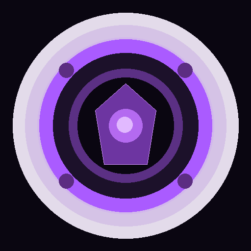

# Thanos Virtual Camera

Virtual camera for **Linux and Windows**. It removes people from your webcam output with a Thanos-style particle effect, or replaces/blurs your background. Use it as the camera in **Google Meet**, **Zoom**, **Microsoft Teams**, or any app that can select a virtual camera.



## Features

- **Remove person**: person pixels dissolve into dust-like particles and disappear.
- **Virtual background**: keep the person and replace the room.
- **Background blur**: keep the person and blur the room.
- **Desktop control window**: `1`–`4` mode shortcuts and `B` capture background.
- **Native C++ backend**: no Python runtime, MediaPipe, TensorFlow, or PyInstaller in the packaged application.
- **ONNX Runtime + U²-Net-P** (~4.4 MB) for salient/person segmentation.
- **Linux**: writes directly to `v4l2loopback` at `/dev/video10`.
- **Windows**: writes directly to the OBS-compatible `OBSVirtualCamVideo` shared-memory queue.
- Browser/Electron mode: buttons are local to the application and are not visible in Meet/Zoom/Teams.

## Requirements

### Linux
- `v4l2loopback`
- `/dev/video10`

```bash
sudo modprobe v4l2loopback devices=1 video_nr=10 card_label="VirtualCam" exclusive_caps=1
```

### Windows
- OBS Studio with its Virtual Camera component
- Select **OBS Virtual Camera** in Meet/Zoom/Teams
- The webcam must expose an uncompressed video format (YUY2, NV12, or RGB32) through Media Foundation. Many USB webcams provide YUY2 at 640×480.

## Build from source

```bash
npm install
npm run build:native
npm start
```

Linux build requirements:

```bash
sudo apt-get install cmake ninja-build curl
```

The build downloads the pinned ONNX Runtime SDK v1.31.1 (Apache-2.0) automatically and verifies SHA-256.

## Package

```bash
npm run dist
```

Build artifacts are written to `dist/`.

## GitHub Releases

Push a version tag to build and publish packages:

```bash
git tag v0.2.0
git push origin main --tags
```

Packages are attached to the GitHub Release.

## Repository layout

```text
native/               C++ camera backend
  src/main.cpp        camera pipeline, HTTP control API and effects
  src/v4l2_camera.cpp Linux capture and output
  src/windows_camera.cpp Windows Media Foundation capture and OBS shared-memory output
models/               U²-Net-P weights and model license
src/                  Electron desktop application
chrome-extension/     optional browser extension
scripts/
  fetch-native-deps.mjs pinned ONNX Runtime download
  build-native.mjs    native build and install pipeline
```

## Size

The native backend binary is about 170 KB and its ONNX Runtime shared library is about 28 MB. Actual installer/AppImage size is still dominated by Electron/Chromium, but the Python/MediaPipe backend has been removed.

## License

GPL-3.0-or-later. See `LICENSE`, `NOTICE-THIRD-PARTY.md`, and `models/u2netp-LICENSE.md`.
